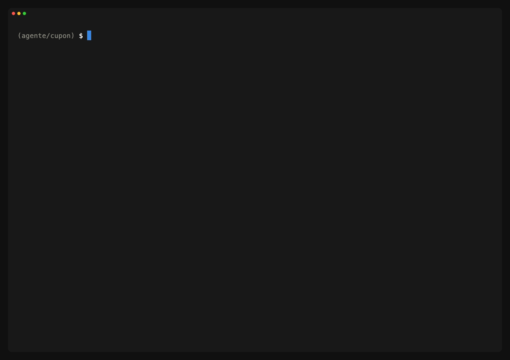

# hoomAI

**Your AI agent says "done". hoom checks.**

[Español](README.md) · [Tutorial (Spanish)](docs/tutorial.md) · [Commands](#main-commands) · [MIT License](LICENSE)

> **Note:** for now hoom speaks Spanish. The CLI output, `hoom help`, the agent
> contracts in `.hoom/agents/`, the full reference ([README.md](README.md)) and
> the tutorial ([docs/tutorial.md](docs/tutorial.md)) are in Spanish. This page
> covers what hoom is, how to install it and the main commands.

`hoom` is a CLI that sits between your AI agent and your branch. It runs your
stack's gates (tests, static analysis, mutation testing, architecture,
security) on the exact tree the agent hands over and writes a verdict: green
ships, red doesn't (exit 1). What the agent says it did doesn't count; the
verdict does.

- **Deterministic gates, immutable verdict in git.** Every `hoom verify`
  writes a new file in `.hoom/verdicts/` (one per run, append-only) with the
  fingerprint of the tree it verified, and it travels with the project in git.
  `hoom check` tells you whether the tree you have now is still that one: if
  the agent touched anything after the green, there is no green.
- **Blind test-writer and cross-provider review.** The test-writer writes the
  tests from the spec in a worktree with no implementation on disk, and
  `hoom review` runs the reviewer on a different provider from the one that
  wrote the code (Claude Code ↔ Codex CLI).
- **Drives your AI CLI on your subscription; never calls an API.** hoom
  launches Claude Code or Codex CLI as a subprocess, with the account you
  already use them with. The binary never talks to a model.

What hoom can't prevent, it says: `hoom roles` labels every limit of every role
as ENFORCED, POST-VERIFIED, BEST-EFFORT or UNSUPPORTED. For example, the blind
test-writer's read limit is BEST-EFFORT: git's object database is shared, and
`git show HEAD:<path>` still reaches the implementation.



## One-command install

```sh
# Linux / macOS
curl -fsSL https://raw.githubusercontent.com/hoomdev/hoomai/main/install.sh | sh
```

```powershell
# Windows (PowerShell)
irm https://raw.githubusercontent.com/hoomdev/hoomai/main/install.ps1 | iex
```

It downloads the binary from the latest release: macOS and Linux (amd64 and
arm64) and Windows (amd64). On Linux and macOS it checks the checksum against
the release's `checksums.txt` (with `sha256sum` or `shasum`).

Alternatives:

```sh
go install github.com/hoomdev/hoomai/cmd/hoom@latest   # with Go 1.25+
go build -o hoom ./cmd/hoom                               # from the repo (vendor included, no network)
```

## 60-second usage

```sh
cd my-project
hoom init        # detects the stack (laravel|kmp|kmp-compose|go) and writes hoom.yaml
hoom verify      # runs the gates and writes a verdict: RED = exit 1
hoom agents      # installs the 10 agent contracts and binds AGENTS.md
```

From then on your agent reads the contract in `AGENTS.md`: before calling a
change done it runs `hoom verify` and attaches the verdict's path. You don't
take its word for it: you run `hoom check`.

```sh
hoom check       # the current tree against the last verdict: green + matching fingerprint = OK
hoom status      # the referee's window: check, live gates, roles, tasks
hoom cockpit     # your AI CLI + status --watch in one command (tmux/zellij)
hoom report      # history and trend per gate
hoom serve       # HoomAI Studio: local dashboard + cockpit on 127.0.0.1:4666
```

## Supported stacks today

Three stacks: **Go**, **Laravel** and **Kotlin Multiplatform** (with or
without Compose). `hoom init` detects them and writes their profile's gates
into `hoom.yaml`, where you edit them.

| Stack | Profile | Gates with a command after `hoom init` | Empty (YELLOW until you fill them) |
|---|---|---|---|
| Go | `go` | `go test -race`, `go vet`, `go build`, Gremlins | golangci-lint, arch-go, Semgrep |
| PHP / Laravel | `laravel` | Pest, PHPStan, Pint, Pest architecture tests, Infection | build, Semgrep |
| Kotlin Multiplatform | `kmp` | Gradle `allTests`, detekt, Konsist, Pitest (JVM target only), `assemble` | lint, Semgrep |
| Compose Multiplatform | `kmp-compose` | everything in `kmp` + `./gradlew lint` | everything in `kmp` + Compose compiler metrics |

Any other stack has no profile: `hoom init` doesn't guess, it refuses and asks
for `--profile`. Gates are commands in `hoom.yaml` and you can rewrite them by
hand, but that is not a supported stack.

## Which AI CLIs

| CLI | What hoom does with it |
|---|---|
| Claude Code, Codex CLI | Everything: `hoom run`, roles inside the envelope (`hoom agent`), the blind test-writer and the cross review (`hoom review`) |
| OpenCode, Gemini CLI | `hoom run` and native subagents (`hoom agents --target`). They don't run roles inside the envelope: they don't take a system prompt, and `hoom roles` marks them UNSUPPORTED |

`hoom providers` tells you which ones you have installed and what each one
declares.

## Philosophy

The core idea: trust never lives in the model. It lives in **deterministic
gates** (tests, static analysis, mutation testing, architecture tests) bound
to the real scope derived from Git, recorded as **immutable verdicts** that
travel with the project. The agent's narration doesn't count; only the
evidence does.

1. **AI-agnostic**: hoom never talks to a model. Any agent (Claude Code,
   OpenCode, Codex CLI, Gemini CLI, Ollama) is bound to the same contract:
   `hoom verify` before handing over, red verdict = it doesn't ship.
2. **Anti-circularity**: an AI can't review its own code. That's why the
   test-writer is adversarial (it writes from the spec and is never shown the
   implementation) and mutation testing measures the quality of the tests,
   not just that they exist.
3. **Declared degradation, never silent**: a gate with no command shows up in
   YELLOW in every verdict. An incomplete safety net is visible, not hidden.
4. **Strict policy**: fail or error in a required gate = RED verdict = exit 1.
   A tool that is configured but broken = ERROR (fail-closed), also red.
5. **Append-only verdicts in Git**: `.hoom/verdicts/<timestamp>_<hash>.json`,
   one file per run, zero merge conflicts by construction. The history travels
   with the project across machines and CI.

## Main commands

| Command | What it does |
|---|---|
| `hoom init` | Detects the stack, writes `hoom.yaml` with the profile's gates and creates `.hoom/` |
| `hoom verify` | Runs the gates and writes a verdict (red = exit 1) |
| `hoom verify --full` | Ignores diff scoping (full run, e.g. nightly) |
| `hoom verify --gate test,static` | Runs only those gates; the verdict is PARTIAL, and `check` and `task done` never use it as reference |
| `hoom verify --spec <path>` | Adds the `spec_lint`, `spec_trace` and `spec_approved` gates: every CA-n criterion needs a test that references it (or a `[verifica: <command>]`), and the spec needs a current human approval |
| `hoom verify --json` | The verdict as JSON on stdout, for agents |
| `hoom check` | Compares the CURRENT tree with the last verdict: green + matching fingerprint = OK |
| `hoom status [--watch]` | The referee's window: check, last verdict, the verify in progress (live gates), active runs with their role, tasks and findings. Read-only |
| `hoom report -n 10` | Verdict history and pass-rate trend per gate |
| `hoom agents [--target all]` | Installs the 10 agent contracts in `.hoom/agents/` and binds `AGENTS.md`; `--target` also generates native subagents for Claude Code, OpenCode, Codex and Gemini CLI |
| `hoom agent --role <role> "<request>"` | Runs one role inside a deterministic envelope: its contract as system prompt, its write limit, one CLI run, then scope → verify → check. The test-writer runs in a blind tree |
| `hoom review` | The cross review: the reviewer runs on a different provider from the one that wrote the code, with one lens or all four (risk, reliability, resilience, readability) chosen from the evidence. It doesn't write a verdict: that's `verify`'s job |
| `hoom run --provider <p> "<prompt>"` | Runs your AI CLI headless on the project or a task's worktree; hoom never calls a model API |
| `hoom providers` | Which AI CLIs are installed and the capabilities each one declares |
| `hoom roles` | Enforcement matrix: what each role can read, write and run with each provider, by which mechanism, and in which category (ENFORCED, POST-VERIFIED, BEST-EFFORT, UNSUPPORTED) |
| `hoom finding add` / `resolve` / `list` | Review findings as immutable files in `.hoom/findings/`; closing one without evidence is refused |
| `hoom spec approve <path>` / `status <path>` | Human approval bound to the SHA-256 of the spec's content; editing the spec afterwards invalidates it |
| `hoom task start` / `list` / `done <slug>` | Isolated parallel tasks: branch `hoom/<slug>` + its own worktree + its own verdicts; `done` closes only with a green verdict, matching fingerprint and everything committed |
| `hoom board` / `hoom tablero` | The board: each item's column is derived from its evidence; `tablero` is the full-screen terminal version |
| `hoom costo [<slug>]` | What each task cost until accepted, read from the evidence: tokens, API-equivalent USD and window per provider |
| `hoom cockpit` | Your AI CLI in a real pane + `status --watch` next to it (tmux/zellij) |
| `hoom serve` | HoomAI Studio: local dashboard embedded in the binary (default 127.0.0.1:4666); actions need the token it prints at startup |
| `hoom hook` | Installs the Git pre-push hook that requires `hoom check` |
| `hoom ratchet init` | The ratchet baseline: declared metrics that can only go up; loosening one requires a reason and is recorded |

The full table, with every flag, is in the [Spanish README](README.md#comandos).

## License

MIT
