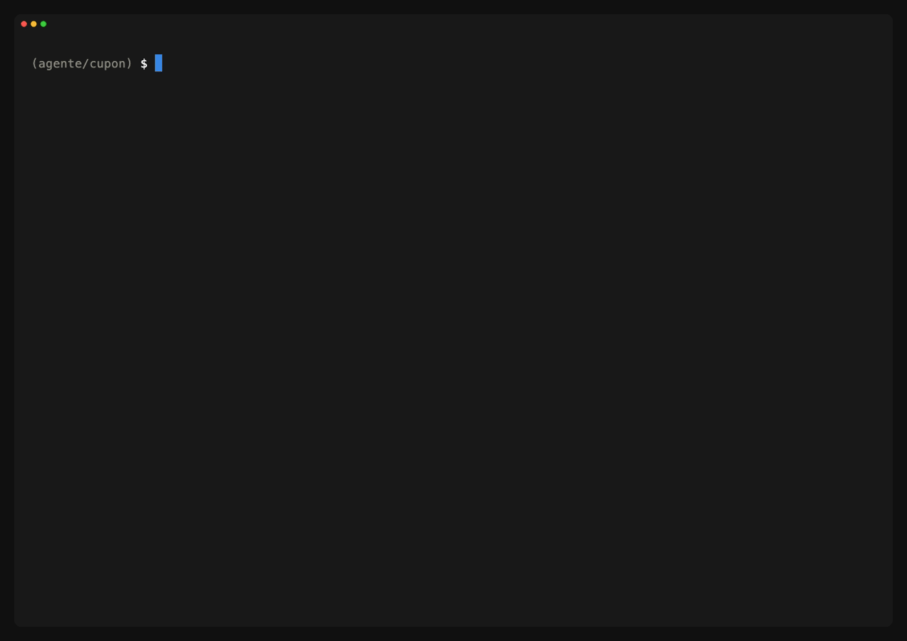

# hoomAI

**Tu agente de IA dice «listo». hoom lo comprueba.**

[English](README.en.md) · [Tutorial](docs/tutorial.md) · [Comandos](#comandos) · [Licencia MIT](LICENSE)

`hoom` es un CLI que se pone entre tu agente de IA y tu rama. Corre los gates de
tu stack (tests, análisis estático, mutation testing, arquitectura, seguridad)
sobre el árbol exacto que el agente entrega y emite un veredicto: verde se
entrega, rojo no (exit 1). Lo que el agente cuenta que hizo no cuenta; cuenta
el veredicto.

- **Gates deterministas, veredicto inmutable en git.** Cada `hoom verify`
  escribe un archivo nuevo en `.hoom/verdicts/` (uno por corrida, append-only)
  con la huella del árbol que verificó, y viaja con el proyecto en git.
  `hoom check` dice si el árbol de ahora sigue siendo ese: si el agente tocó
  algo después del verde, ya no hay verde.
- **Test-writer ciego y review cruzada entre providers.** El test-writer
  escribe los tests desde el spec en un worktree sin la implementación en
  disco, y `hoom review` corre el reviewer en un provider distinto del que
  escribió el código (Claude Code ↔ Codex CLI).
- **Maneja tu CLI de IA con tu suscripción; nunca llama a una API.** hoom
  lanza Claude Code o Codex CLI como subproceso, con la cuenta con la que ya
  los usas. El binario no habla con ningún modelo.

Lo que hoom no puede impedir, lo dice: `hoom roles` marca cada límite de cada
rol como ENFORCED, POST-VERIFIED, BEST-EFFORT o UNSUPPORTED. Por ejemplo, la
lectura del test-writer ciego es BEST-EFFORT: el object DB de git es compartido
y `git show HEAD:<ruta>` todavía llega a la implementación.

<!-- Demo: descomentar cuando exista docs/demo.gif

-->

## Instalación en un comando

```sh
# Linux / macOS
curl -fsSL https://raw.githubusercontent.com/hoomdev/hoomai/main/install.sh | sh
```

```powershell
# Windows (PowerShell)
irm https://raw.githubusercontent.com/hoomdev/hoomai/main/install.ps1 | iex
```

Baja el binario del último release: macOS y Linux (amd64 y arm64) y Windows
(amd64). En Linux y macOS verifica el checksum contra el `checksums.txt` del
release (con `sha256sum` o `shasum`).

Alternativas:

```sh
go install github.com/hoomdev/hoomai/cmd/hoom@latest   # si tienes Go 1.25+
go build -o hoom ./cmd/hoom                               # desde el repo (vendor incluido, sin red)
```

## Uso en 60 segundos

```sh
cd mi-proyecto
hoom init        # detecta el stack (laravel|kmp|kmp-compose|go) y crea hoom.yaml
hoom verify      # ejecuta los gates y emite un veredicto: ROJO = exit 1
hoom agents      # instala los 10 contratos de agentes y ata AGENTS.md
```

Desde ahí tu agente lee el contrato en `AGENTS.md`: antes de dar un cambio por
terminado corre `hoom verify` y adjunta la ruta del veredicto. Tú no le crees:
corres `hoom check`.

```sh
hoom check       # el arbol de ahora contra el ultimo veredicto: verde + huella coincidente = OK
hoom status      # la ventana del arbitro: check, gates vivos, roles, tareas
hoom cockpit     # tu CLI de IA + status --watch en un solo comando (tmux/zellij)
hoom report      # historial y tendencia por gate
hoom serve       # HoomAI Studio: dashboard + cockpit local en 127.0.0.1:4666
```

## Stacks que soporta hoy

Tres stacks: **Go**, **Laravel** y **Kotlin Multiplatform** (con o sin
Compose). `hoom init` los detecta y escribe los gates de su perfil en
`hoom.yaml`, donde los editas.

| Stack | Perfil | Gates con comando al hacer `hoom init` | Vienen vacíos (AMARILLO hasta que los llenes) |
|---|---|---|---|
| Go | `go` | `go test -race`, `go vet`, `go build`, Gremlins | golangci-lint, arch-go, Semgrep |
| PHP / Laravel | `laravel` | Pest, PHPStan, Pint, tests de arquitectura de Pest, Infection | build, Semgrep |
| Kotlin Multiplatform | `kmp` | Gradle `allTests`, detekt, Konsist, Pitest (solo target JVM), `assemble` | lint, Semgrep |
| Compose Multiplatform | `kmp-compose` | lo de `kmp` + `./gradlew lint` | lo de `kmp` + métricas del Compose compiler |

Otro stack no tiene perfil: `hoom init` no adivina, se niega y te pide
`--profile`. Los gates son comandos en `hoom.yaml` y se pueden reescribir a
mano, pero eso no es un stack soportado.

## Con qué CLIs de IA

| CLI | Qué hace hoom con ella |
|---|---|
| Claude Code, Codex CLI | Todo: `hoom run`, los roles bajo el sobre (`hoom agent`), el test-writer ciego y la review cruzada (`hoom review`) |
| OpenCode, Gemini CLI | `hoom run` y los subagentes nativos (`hoom agents --target`). No corren roles bajo el sobre: no aceptan system prompt, y `hoom roles` los marca UNSUPPORTED |

`hoom providers` dice cuáles tienes instaladas y qué declara cada una.

## Filosofia

hoomAI es un harness de verificacion **agnostico de IA y de stack** para desarrollo asistido por agentes.

La idea central: la confianza nunca vive en el modelo. Vive en **gates deterministicos**
(tests, analisis estatico, mutation testing, tests de arquitectura) atados al scope real
derivado de Git, registrados como **veredictos inmutables** que viajan con el proyecto.
La narracion del agente no cuenta; solo cuenta la evidencia.

1. **Agnostico de IA**: hoomAI nunca habla con un modelo. Cualquier agente (Claude Code,
   OpenCode, Codex CLI, Gemini CLI, Ollama) se ata al mismo contrato: `hoom verify` antes
   de entregar, veredicto rojo = no se entrega.
2. **Anti-circularidad**: la IA no puede revisar su propio codigo. Por eso el test-writer
   es adversarial (escribe desde el spec, JAMAS ve la implementacion) y el mutation
   testing mide la calidad de los tests, no solo su existencia.
3. **Degradacion declarada, nunca silenciosa**: un gate sin comando aparece en AMARILLO
   en cada veredicto. La red de seguridad incompleta se ve; no se oculta.
4. **Politica estricta**: fail o error en un gate requerido = veredicto ROJO = exit 1.
   Herramienta configurada pero rota = ERROR (fail-closed), tambien rojo.
5. **Veredictos append-only en Git**: `.hoom/verdicts/<timestamp>_<hash>.json`, un archivo
   por corrida, cero conflictos de merge por construccion. El historial viaja con el
   proyecto entre maquinas y CI. Cualquier indice (SQLite futuro) es cache regenerable.

## Comandos

| Comando | Que hace |
|---|---|
| `hoom init` | Detecta el stack, crea `hoom.yaml` con los gates del perfil materializados y `.hoom/` |
| `hoom verify` | Ejecuta los gates y emite un veredicto (rojo = exit 1) |
| `hoom verify --full` | Ignora el scoping por diff (corrida completa, ej. nocturna) |
| `hoom verify --gate test,static` | Ejecuta solo esos gates |
| `hoom report -n 10` | Historial de veredictos + tendencia de pass-rate por gate |
| `hoom report --json` | El mismo historial como JSON en stdout (para agentes y el Studio) |
| `hoom check` | Compara el arbol ACTUAL contra el ultimo veredicto: verde + huella coincidente = OK |
| `hoom check --json` | El mismo check como JSON en stdout, mismo exit code |
| `hoom status` | La ventana del arbitro: check, ultimo veredicto, verify en curso (gates vivos), runs activos con su rol, tareas y hallazgos. Solo lectura, nunca bloquea. `--json` |
| `hoom status --watch` | El mismo snapshot refrescando en vivo, pensado para una segunda terminal junto a tu CLI de IA. Sin TTY imprime una vez, sin ANSI |
| `hoom cockpit` | Arma el puesto completo sobre tmux/zellij: tu CLI de IA en un pane real + `status --watch` al lado. `--provider <p>`, `--task <slug>` (monta el cockpit en el worktree de la tarea), `--mux tmux\|zellij` |
| `hoom ratchet init` | Crea la linea base del trinquete (`.hoom/ratchet.json`, viaja en Git): metricas declaradas como comandos cuya ultima linea es un numero |
| `hoom ratchet lower <m> --to <v> --reason "..."` | Afloja UNA base con razon obligatoria y registro auditable; sin razon se niega. Apretar no tiene comando: solo lo hace una medicion de `verify --full` |
| `hoom serve` | HoomAI Studio: dashboard local embebido en el binario (default 127.0.0.1:4666). Lectura libre en loopback; acciones (verify, tareas, aprobar specs, intake, y las de cada tarjeta del tablero) con el token que imprime al arrancar |
| `hoom spec approve <ruta>` | Registra la aprobacion humana del spec atada al SHA-256 de su CONTENIDO (append-only en `.hoom/approvals/`); editarlo despues la invalida |
| `hoom spec status <ruta>` | aprobado / no-aprobado / invalidado; exit 0 solo con aprobacion vigente (gateable por script) |
| `hoom context` | Salud del contexto: fuentes de intake, vision/backlog, preguntas abiertas y staleness por fechas. Amarillos honestos; informa, nunca bloquea. `--json` |
| `hoom finding add --sev <s> "<desc>"` | Registra un hallazgo de review como artefacto INMUTABLE en `.hoom/findings/`, atado a la huella del arbol. `--task <slug>` lo ata a una tarea; sin el flag toma `HOOM_TASK`, que hoom pone en cada run con tarea, asi que lo que un rol registra dentro de `hoom agent --task` queda en su tarjeta. En `hoom review` es la tarea de la review: `--task`, o si no la del `--spec`; el reviewer recibe la ruta absoluta del hoom que lo lanzo (el del PATH de un shell de login puede ser otra version; en Windows, `hoom` a secas), y un hallazgo nuevo fuera de esa tarea (sin tarea o con otra) queda avisado en la salida y anotado en `notes` del registro de review y del `--json` |
| `hoom finding resolve <id> --as corregido\|refutado --evidence "..."` | Cierra un hallazgo (transicion terminal unica); SIN evidencia el binario se niega |
| `hoom finding list [--open] [--json]` | Estado derivado de cada hallazgo; marca los que quedaron atras del codigo. Una resolucion sin evidencia, con un estado inventado o ilegible NO cierra nada: el hallazgo sigue abierto (y lo dice un aviso) |
| `hoom providers` | Detecta que CLIs de IA hay instaladas (claude, opencode, codex, gemini) y las capacidades que declara cada una (stream, continue, resume, session_id, model, system_prompt, tools, read_only, max_turns, budget). `--json` |
| `hoom run --provider <p> [--task <slug>] "<prompt>"` | Lanza TU CLI de IA en headless sobre el proyecto o el worktree de la tarea. hoom nunca llama a una API de modelo; la narracion queda en `.hoom/runs/` (local, fuera de la huella y de Git). Opciones: `--resume <id>` (reanuda la sesion del provider que imprimio un run anterior), `--model <m>`, `--system-prompt <texto\|@ruta>` (se AGREGA al del provider; `@ruta` lee un contrato de rol), `--allow-tools a,b`, `--deny-tools a,b`, `--max-turns n`, `--budget-usd x`. Lo que el provider no soporta se ignora CON aviso en el log; `--strict` lo vuelve error. `--unattended`: nadie responde prompts, el CLI recibe de entrada las herramientas para leer, escribir y ejecutar |
| `hoom agent --role <rol> [--task <slug>] [--spec <ruta>] "<pedido>"` | El SOBRE determinista de un rol: le da su contrato como system prompt, le impone su limite de escritura con el mecanismo que el provider declare (deny de herramientas en Claude, sandbox en Codex), corre el CLI UNA vez y cierra con evidencia en orden fijo — **scope** (que toco el rol, comparando el arbol antes y despues), **verify** y **check**. El gate de scope responde lo que ningun prompt puede responder: si el rol escribio solo donde le correspondia y dejo la evidencia intacta. Piso no aflojable: veredictos y hallazgos existentes son inmutables, las aprobaciones no las firma un agente, `hoom.yaml` no se toca, el trinquete solo sube, y los items y los registros de review (`.hoom/items/`, `.hoom/reviews/`) no los toca un rol; violarlo corta ANTES de emitir veredicto. Cada violacion se registra como hallazgo `high`. El **test-writer** corre ademas en un **arbol ciego**: un worktree disperso (`git sparse-checkout`) de UN commit que contiene lo que el rol puede leer —el spec, los tests, los archivos con los que el perfil reconoce el stack— y ni un archivo de implementacion, asi que la anti-circularidad deja de ser una regla de prompt. Ese arbol es tambien una cuarentena: solo se trasplantan al arbol real las rutas que el gate aprobo, y si el aislamiento se rompe (un archivo escondido que vuelve al disco, o una escritura en el arbol real) no se emite veredicto. El rol ciego corre ademas sin la configuracion personal del CLI, igual que `hoom review`: en claude, sin los servidores MCP del usuario (Engram incluido), sin sus hooks, plugins ni permisos y sin la memoria automatica del proyecto, que comparten todos los worktrees del repo; en codex, sin su `config.toml`. Un provider que no puede aislarse no corre un rol ciego: el sobre se niega en el paso aislar, antes de armar el arbol. Los autores de specs (**arquitecto**, **designer**, **analista**) escriben solo en `.hoom/specs/**` y sin shell, y no reciben `--spec`: escriben el spec, no se verifican contra el. Un rol que escribe y termina sin entregar nada (salvo la evidencia que genera hoom) cierra **SIN ENTREGA**, exit 1, sin verify ni check: no hay arbol nuevo que certificar. Un pedido de relleno (`...`, espacios, `<pedido>`) se rechaza antes de gastar un token. Opciones: `--provider <p>` (default: el primero instalado que soporte system prompt), `--model`, `--resume <id>`, `--max-turns n`, `--budget-usd x`, `--json`. Exit 0 solo con todos los pasos verdes (cinco; seis con un rol ciego) |
| `hoom review [--provider p] [--lens l]` | La review CRUZADA: corre el rol reviewer en un provider **distinto del que escribio** (lo dice el meta del ultimo run, no la memoria de nadie) y se niega si serian el mismo, salvo `--same-provider`. Las sesiones interactivas que declara el item (`sesiones`, las anota `hoom cockpit --task` con tmux) suman writers DECLARADOS: un reviewer igual a uno de ellos tampoco es cruzado, y sin writer observado la review es `cruzada-declarada`, nunca `cruzada`. Deja un registro de sobre en `.hoom/envelopes/` como `hoom agent`. La lente sale de la EVIDENCIA con la regla del contrato 06: solo documentacion no invoca review, una ruta de riesgo o mas de 400 lineas (`insertions+deletions` del veredicto) piden las 4 lentes, el resto una. Las lentes corren en orden risk, reliability, resilience, readability. hoom congela UNA vez la evidencia (el diff del candidato sin el estado de hoom y el texto del spec) y la pone entera en el pedido de cada lente, antes de la linea de la lente; si pasa el tope (`review.max_evidence_kib`, 320 KiB por defecto) no corre ninguna lente y la review es NO ENTREGABLE: hoom no la corta. El reviewer corre **aislado** de la config personal del provider (Codex `--ignore-user-config`; Claude `--strict-mcp-config --setting-sources project` y `--settings {"autoMemoryEnabled":false}`, sin la memoria automatica), con el modelo y el esfuerzo que se eligen con `--model` / `--effort` o en `hoom.yaml`; la salida los muestra, junto con el gasto que informa el provider por lente, y el registro de review los guarda. El resultado son los hallazgos que hoom VE aparecer en `.hoom/findings/` durante el run, no los que el CLI dice haber registrado. No emite veredicto ni juzga el codigo: eso sigue siendo de `verify`. Con `--desde <commit>` revisa solo de ese commit a `HEAD`, y con `--delta` solo lo que cambio desde la ultima review completa o delta de la tarea (no van juntos). La base sale del `hoom.yaml` del proyecto (el arbol donde corre hoom) o de `--base <ref>`, nunca del `hoom.yaml` de la rama: si la rama declara otro `base_branch`, la review lo avisa y sigue con la del proyecto. Opciones: `--task`, `--spec`, `--desde`, `--delta`, `--base`, `--model`, `--effort`, `--same-provider`, `--max-turns`, `--budget-usd`, `--json` |
| `hoom hook` | Instala el pre-push de Git que exige `hoom check` antes de integrar |
| `hoom verify --json` | Veredicto como JSON en stdout, para consumo de agentes (in-band); la linea de progreso se va por stderr para que stdout quede parseable byte por byte |
| `hoom verify --help` | El uso EXACTO del verbo por stdout, exit 0 y cero artefactos. Es la misma constante que imprime `hoom help`: no hay un segundo texto que pueda desincronizarse |
| `hoom verify --spec <ruta>` | Suma los gates `spec_lint`, `spec_trace` y `spec_approved`: cada criterio CA-n debe tener un test que lo referencie o declarar `[verifica: <comando>]` (exit 0 = trazado), y el spec debe tener aprobacion humana VIGENTE (hash de contenido) |
| `hoom verify --gate a,b` | Corre solo esos gates; el veredicto queda PARCIAL: diagnostico util, pero `check` y `task done` NUNCA lo usan como referencia |
| `findings: { block_on: high }` en `hoom.yaml` | Suma a `verify` el gate `findings_open` (requerido): ROJO con hallazgos abiertos de esa severidad o mayor, ids y lente en las notas; los menores se informan y no bloquean. Con `--spec` cuenta los de la tarea del spec (el nombre del archivo) y los sin tarea. Ver [Hallazgos que bloquean](#hallazgos-que-bloquean-gate-findings_open) |
| `hoom task start <slug>` | Tarea paralela aislada: rama `hoom/<slug>` + worktree propio + sus propios veredictos |
| `hoom task list` | Estado de las tareas activas (verde listo / drift / rojo / sin veredicto) |
| `hoom task list --json` | El mismo estado como JSON en stdout |
| `hoom task discard <slug> [--yes] [--json]` | Descarta lo que el espacio de trabajo de la tarea tiene sin guardar FUERA de `.hoom/`: lo que `HEAD` tiene vuelve a como estaba, lo nuevo se borra. La evidencia (veredictos, hallazgos, aprobaciones, registros) nunca se descarta. Sin `--yes` solo lista y sale con 1; se niega con un run activo en el arbol |
| `hoom task done <slug>` | Cierra la tarea SOLO con veredicto verde, huella coincidente y todo commiteado. Si el arbol donde corre tiene el item de la tarea, le escribe `hecho_en` y `commit_final` (la punta de `hoom/<slug>`); con `--force` nunca lo marca hecho |
| `hoom item add "<titulo>"` | Crea la tarjeta como archivo: `.hoom/items/<slug>.yaml` (viaja en git, uno por item). `--tipo feature\|bug\|refactor\|seguridad\|docs\|test`, `--prioridad alta\|media\|baja`, `--presupuesto-usd x`, `--pedido "..."`, `--slug s`, `--auto hasta-humano` (el piloto automatico del Studio; exige `--presupuesto-usd`), `--json`. El slug es tambien el del spec y el de la tarea |
| `hoom item list [--json]` / `hoom item show <slug> [--json]` | Los items del arbol actual; `show` suma su tarjeta (columna, que falta, siguiente paso, subestados y, en `--json`, las acciones validas, adonde se puede soltar y el fantasma) |
| `hoom item save <slug> [--json]` | Guarda en git lo que la tarjeta tiene sin guardar: un commit por arbol (su espacio de trabajo, y el item en el proyecto) con el mensaje fijo `hoom: guardar la tarjeta <slug>`. Solo esas rutas: lo que haya en el indice queda como estaba. Se niega mientras un rol trabaja en la tarjeta |
| `hoom board [--json]` | El tablero: la columna de cada item sale de su EVIDENCIA (spec, aprobacion, tests con CA-n, veredicto, review, hallazgos, cierre). Nadie escribe columnas y nada se guarda. Solo lectura, exit 0 |
| `hoom board doctor [--json]` | Donde la evidencia no es coherente, cada problema con su accion exacta: spec editado despues de aprobarlo, espacio de trabajo con cambios sin veredicto para su huella, verde cuya huella ya no es la del arbol, hallazgo high en Tu aceptacion (un bug de hoom, y lo dice), sobres huerfanos, items sin spec hace mas de 14 dias y veredictos o hallazgos de una tarea sin item. Solo lee y sale con 0: los que bloquean son `verify` y `check` |
| `hoom tablero` | El tablero en la terminal, a pantalla completa y en paneles, con el teclado y el mouse: la misma derivacion que `hoom board --json` y el Studio, releida cada 2 segundos. Cada accion, salvo `u`, muestra en un modal el comando que se va a ejecutar y ejecuta un verbo de la tarjeta (`hoom pedir`, `aprobar`, `guardar`, `integrar`, `reanudar`, `usar`) como proceso propio. Sin terminal sale con 2 y dice `hoom board`. Ver [El tablero en la terminal](#el-tablero-en-la-terminal) |
| `hoom costo [<slug>] [--json]` | Lo que costo cada tarea hasta quedar aceptada, solo leyendo la evidencia. Sin slug, primero `hoy: <usd> USD en <n> trabajos` (los runs que empezaron hoy en la hora local; `hoy: sin trabajos` si no hay) y despues una linea por tarea con runs o reviews, de la mas reciente a la mas vieja: estado, rondas de review y, por provider, tokens, USD equivalente API y ventana. Con slug, el desglose por rol y por ronda de review y el total por provider. `--json` emite el mismo reporte (sin slug, con `"hoy"`: runs, costo_usd y sin_costo). Lo que falta dice `sin dato`; un slug sin runs ni reviews sale con 1 |
| `hoom roles [--role r] [--provider p] [--json]` | Matriz de enforcement: que puede leer, escribir y ejecutar cada rol con cada provider, con que mecanismo (deny de tools, sandbox, arbol ciego, gate post-run) y en que categoria: ENFORCED, POST-VERIFIED, BEST-EFFORT o UNSUPPORTED |
| `hoom agents` | Instala los 10 contratos de agentes en `.hoom/agents/` y ata `AGENTS.md` |
| `hoom agents --target all` | Genera ademas los subagentes NATIVOS de Claude Code, OpenCode, Codex y Gemini CLI |
| `hoom profiles` | Lista los perfiles embebidos |

## Perfiles (v1)

- **laravel** - Pest/PHPUnit, PHPStan, Pint, arch tests de Pest, Infection (mutation por
  diff con `--git-diff-base`).
- **kmp** - Gradle allTests, detekt, Konsist, Pitest (parcial declarado: solo target JVM).
- **kmp-compose** - hereda kmp + lint de Compose + metricas del Compose compiler.
- **go** - go test -race (diff por paquetes), go vet, golangci-lint, arch-go, Gremlins.

Los perfiles son defaults: `hoom init` los materializa en `hoom.yaml` y ahi los editas.
`cmd: ""` declara un gate AUSENTE explicitamente (amarillo, nunca oculto). La herencia
(`extends`) permite crear perfiles derivados (ej. un futuro `filament extends laravel`).

## Manifiesto (hoom.yaml)

```yaml
schema: hoom/v1
project: mi-proyecto
profile: laravel
base_branch: main
policy: strict
gates:
  test:
    required: true
    cmd: "vendor/bin/pest --colors=never"
  mutation:
    required: true
    cmd: "vendor/bin/infection --threads=max --no-progress --min-msi=60"
    diff_cmd: "vendor/bin/infection --threads=max --no-progress --git-diff-filter=AM --git-diff-base={base} --min-msi=60"
```

Opcional, a nivel proyecto (los perfiles no lo traen):

```yaml
findings:
  block_on: high   # low | medium | high: esa severidad o mayor pone ROJO a verify
```

Los valores con que se lanza cada rol, tambien a nivel proyecto. Todas las
claves son opcionales; una clave desconocida, un provider que no es de hoom,
un `budget_usd` negativo o un `timeout` sin unidad o fuera de `1m`..`12h`
hacen invalido el `hoom.yaml`:

```yaml
agents:
  arquitecto:
    provider: claude       # claude | codex | gemini | opencode
    model: opus            # vocabulario del provider; hoom no lo valida
    effort: high           # vocabulario del provider; hoom no lo valida
    budget_usd: 5          # tope por run en USD; 0 = sin tope
    timeout: 45m           # tiempo limite del run, entre 1m y 12h (sin el: 30m)
  test-writer:
    effort: high
    write: { allow: ["tests/**"] }
```

`agents.reviewer` solo acepta `write`: la review se configura en `review:`.
Para cada valor gana el primero que existe: lo que se pide en el comando
(`--provider`, `--model`, `--effort`, `--budget-usd`, `--timeout`) o en el
dialogo del Studio, despues `agents.<rol>` (o `review:`) del `hoom.yaml` del
proyecto, despues lo que propone la tarjeta (el primer provider que puede y
lo que le queda de presupuesto) y por ultimo lo del provider. El presupuesto
de `hoom.yaml` nunca pasa lo que le queda a la tarjeta, y un provider que no
acepta tope (codex) no lo recibe. Los valores salen siempre del `hoom.yaml`
del proyecto, nunca del de la rama de la tarjeta: una rama no se sube su
propio presupuesto ni su tiempo limite.

Variables de template: `{base}` (rama base), `{files}` (archivos cambiados),
`{packages}` (paquetes Go derivados de los .go cambiados). Si un `diff_cmd` expande a
vacio, cae al comando completo en lugar de ejecutar una linea rota.

## Congelamiento del candidato (anti-fraude de veredicto)

Cada veredicto congela una **huella SHA-256 del cambio exacto verificado** (commit +
contenido de cada archivo tocado) y el tamano del cambio (+ins/-del). `hoom check`
compara esa huella contra el arbol actual: si un agente verifica A y entrega B, la
huella no coincide y el check es ROJO con la accion exacta a ejecutar. `hoom hook`
lleva esto al pre-push: sin veredicto verde con huella coincidente, no hay push
(`HOOM_SKIP=1 git push` existe como escape consciente y visible, nunca silencioso).
Mas de 400 lineas cambiadas dispara deterministicamente la review con 4 lentes.
Es la idea central de RDD (Receipt Driven Development) sin la ceremonia
criptografica: el modelo de amenaza local es la deriva, no la falsificacion.

## Trazabilidad spec -> test (spec_lint / spec_trace)

Adaptacion hoomAI de la mutacion de specs de SwarmForge, en version deterministica:
el Arquitecto enumera los criterios de aceptacion como CA-1, CA-2, ... y el
test-writer referencia cada CA-n en sus tests. `hoom verify --spec <ruta>` valida
la estructura del spec (spec_lint) y que cada criterio tenga al menos un test que
lo mencione (spec_trace). Un criterio sin test = veredicto rojo con la accion
exacta a ejecutar. El spec y los tests ya no pueden divergir en silencio.

Para items de TOOLING (criterios que se verifican con `composer`, `phpstan`,
`git`, etc. y no con un test — un test no puede aserir que su propia suite
pasa), el criterio declara su comando en la MISMA linea del CA-n:

```markdown
- CA-7: composer.json valida estricto. [verifica: composer validate --strict]
```

spec_trace ejecuta el comando en la raiz del proyecto: exit 0 = criterio
trazado; cualquier otra cosa = FAIL nombrando CA, comando y exit code. Misma
regla de siempre: exit codes, no narracion. Un marcador en una linea sin
CA-n es issue de spec_lint (huerfano).

## La ventana del arbitro (hoom status)

`hoom verify` narra su corrida en vivo a `.hoom/cache/verify-live.jsonl`
(gitignoreado, fuera de la huella): quien la escribe es el binario de hoom,
la invoque Claude, OpenCode, Codex, Gemini o vos — la visibilidad es
agnostica de IA por construccion. `hoom status --watch` en una segunda
terminal pinta todo en vivo: el check, los gates corriendo con su tiempo,
los runs activos con su rol, las tareas y los hallazgos abiertos.

La narracion es best-effort y jamas toca la evidencia: un cache roto no
altera veredictos ni exit codes, y el status es de solo lectura. El panel
muestra lo que puede probar y rotula lo que no sabe: una corrida muda sin
cierre es un "posible huerfano", y un run sin datos de delegacion dice
"sin delegacion visible" — nunca un rol inventado.

## El cockpit (hoom cockpit)

`hoom cockpit` arma el puesto de trabajo en un comando: tu CLI de IA en un
pane real de terminal y `hoom status --watch` al costado. hoom NO emula
terminales: detecta tmux o zellij en el PATH y compone la sesion — la
emulacion la hace el multiplexor, por eso cualquier CLI corre intacta.
Sin tmux ni zellij instalados, el comando lo dice con la accion exacta
(instalar uno, o abrir el watch en una segunda terminal a mano).

Sin `--provider`, se usa la unica CLI instalada; con varias, el comando
pide elegir — jamas adivina. La sesion es estable por proyecto
(`hoom-<proyecto>`): repetir el comando RE-ADJUNTA en vez de duplicar, y
dentro de tmux cambia de cliente en vez de anidar. Con `--task <slug>` el
cockpit se monta dentro del worktree aislado de esa tarea — la forma
correcta de paralelismo: una sesion de IA por worktree, jamas dos writers
sobre el mismo arbol.

El cockpit lanza y muestra; no dirige. La orquestacion del trabajo sigue
viviendo en tu CLI de IA bajo los contratos de roles, y el veredicto sigue
siendo la unica fuente de verdad.

## El trinquete: calidad que solo puede subir (gate ratchet)

Los gates comparan contra umbrales fijos y no ven la erosion lenta (el MSI
que baja de 82 a 61 en meses, todo verde porque la vara esta en 60) ni
atrincheran las mejoras. El trinquete cierra ese agujero: una linea base de
metricas en `.hoom/ratchet.json` (commiteada, el diff de Git ES su
auditoria) que solo puede moverse hacia MEJOR.

Cada metrica es un COMANDO declarado por el proyecto — mismo contrato
agnostico del manifiesto — cuya ultima linea de salida es un numero, con
`direction` (up/down) y `tolerance` anti-ruido. En cada `hoom verify
--full` (su habitat: la corrida nocturna; los parciales jamas tocan la
base): una metrica sin base se CONGELA en la realidad de hoy; empeorar mas
alla de la tolerancia = gate FAIL con metrica, valor, base y delta exactos
= veredicto ROJO; mejorar = la base se aprieta sola y el equipo hereda el
piso nuevo. Comando roto = ERROR fail-closed, base intacta.

Aflojar existe pero es un comando explicito con `--reason` obligatoria que
deja registro (`history`) — escape consciente y visible, como `HOOM_SKIP`.
La base queda fuera de la huella (estado del harness, no codigo bajo
verificacion): apretar durante un verify jamas rompe el check que ese
mismo verify acaba de ganar.

## Hallazgos que bloquean (gate findings_open)

Los hallazgos de review (`hoom finding add`) son narracion calificada: nacen
atados a la huella del arbol, se cierran UNA vez y con evidencia, y quedan
fuera de la huella del candidato. Por defecto no bloquean nada. Un proyecto
puede decidir que si: con `findings: { block_on: <severidad> }` en
`hoom.yaml`, `verify` suma el gate sintetico `findings_open`, requerido.

- **Abierto** = sin resolucion VALIDA. Valida es `corregido` o `refutado`
  con evidencia no vacia. Una resolucion escrita a mano sin evidencia, con un
  estado inventado o ilegible no cierra nada, y lo mismo cuentan `hoom
  finding list`, `hoom status` y el Studio.
- **Umbral**: `high` bloquea high; `medium`, medium y high; `low`, todo. Los
  abiertos por debajo del umbral salen en la nota y no bloquean.
- **Alcance**: sin `--spec` cuentan todos. Con `--spec .hoom/specs/<slug>.md`
  cuentan los de la tarea `<slug>` y los que no tienen tarea (pueden ser de
  cualquiera); solo quedan afuera los que prueban ser de OTRA tarea.
- **Falla cerrado**: un hallazgo ilegible o con una severidad desconocida es
  ERROR. No corre en una corrida `--gate` (es un diagnostico) y su nombre esta
  reservado.

`hoom check` sigue comparando la huella: un hallazgo registrado DESPUES de un
verde se ve en el proximo `verify`, no antes.

## Veredictos parciales (verify --gate)

`hoom verify --gate a,b` corre solo esos gates y el veredicto queda marcado
**PARCIAL**: se escribe igual (append-only, sirve como diagnostico) pero
`hoom check`, `hoom task done` y el Studio lo ignoran al elegir referencia —
la referencia es siempre el ultimo veredicto COMPLETO. Una corrida
diagnostica de un solo gate jamas se convierte en un check verde apoyado en
gates que no corrieron, ni tapa un verde legitimo con un rojo parcial. Si
solo existen parciales, `hoom check` es ROJO con la accion exacta.

## Argumentos estrictos de verify (exit 2)

`hoom verify` no ejecuta nada que no le pidieron. Un argumento que hoom no
entiende dejo de ser un argumento ignorado y pasa a ser un RECHAZO: exit 2,
el uso exacto por stderr y **cero efectos en disco** — ningun veredicto,
ningun evento vivo en `.hoom/cache/verify-live.jsonl`, ningun trinquete
tocado. Producir un veredicto a partir de un pedido que hoom no entendio es
la misma clase de fraude que el binario ya combate cuando marca PARCIAL una
corrida `--gate`.

| Pedido | Antes | Ahora |
|---|---|---|
| `hoom verify show <id>` | corria una verificacion COMPLETA y escribia un veredicto | exit 2 sin artefactos: `verify` no tiene subcomandos ni posicionales |
| `hoom verify --bogus` | exit 2 con el uso del paquete `flag` de Go (`Usage of verify:`) | exit 2 con el uso de hoom |
| `hoom verify --gate noexiste` | dejaba TODOS los gates en `skipped` y escribia un veredicto VERDE parcial | exit 2 nombrando el gate desconocido y listando los que declara el proyecto |
| `hoom verify --gate ","` | corria TODO, y como veredicto completo de referencia | exit 2: cero gates es ambiguo (¿ninguno o todos?) |

Lo escrito distinto sigue siendo lo mismo: `-full` y `--full`, `--gate=a,b` y
`--gate a,b`, `--gate test,test` y `--gate "test,"` (seleccion inequivoca).
`hoom verify --help` imprime el uso exacto por stdout y sale 0: pedir ayuda no
es un error. Los gates sinteticos (`spec_lint`, `spec_trace`, `spec_approved`,
`ratchet`) no son seleccionables por `--gate`: los gobiernan `--spec` y
`--full`.

**Disciplina de exit codes**: `2` = "no entendi el pedido", y entonces no hay
evidencia; `1` = "entendi y salio ROJO", y el veredicto esta escrito; `0` =
verde. Sin esa separacion un CI no puede distinguir el codigo roto del script
mal escrito.

**Cambio de conducta observable**: un pipeline que hoy pasa basura y sigue en
verde (`hoom verify .`, `hoom verify $DIR` copiado de `hoom init`, un
argumento sobrante de un script viejo) pasa de exit 0 a exit 2. Es exactamente
el objetivo, y va anunciado aca. La validacion de los nombres de gate vive en
`verifycmd.Run`, asi que el `POST /api/verify` del Studio responde **400** al
mismo pedido: una sola validacion para las dos puertas, nunca un segundo
cerebro en el Studio.

La disciplina vive en el paquete `internal/cliargs`, que no conoce ningun
verbo. Los demas verbos siguen ignorando posicionales (`hoom check show <id>`
todavia corre un check): es deuda declarada, y se salda copiando una linea por
verbo. `cliargs.Strict` NO se le puede aplicar tal cual a los verbos que usan
posicionales por contrato (`init <dir>`, `run`/`agent`/`review "<prompt>"`,
`finding add "<desc>"`, `task <slug>`, `spec approve <ruta>`).

## Aprobacion humana atada al contenido (hoom spec)

El punto de control humano del flujo es la aprobacion del spec, y desde v0.5
queda registrada con la misma filosofia de la huella: **lo que se aprueba es
un CONTENIDO exacto, no un nombre de archivo**. `hoom spec approve <ruta>`
guarda un registro append-only en `.hoom/approvals/` con el SHA-256 del
spec, el autor (git config) y la fecha; viaja en Git como los veredictos.
Editar el spec despues de aprobarlo lo INVALIDA por construccion:
`hoom spec status <ruta>` responde aprobado / no-aprobado / invalidado, con
exit 0 solo para una aprobacion vigente — gateable por script o por el
contrato del orquestador. Re-aprobar el mismo contenido es un no-op
informado; el historial de aprobaciones nunca se pisa.

Y desde v0.10 el BINARIO lo hace cumplir: `hoom verify --spec` incluye el
gate **spec_approved** (requerido) — spec sin aprobacion vigente = veredicto
ROJO con la accion exacta. La aprobacion humana dejo de ser una regla de
contrato para ser un gate mas.

## Tareas paralelas aisladas (hoom task)

Adaptacion del worktree-por-rol de SwarmForge a nuestra unidad de trabajo: una
tarea = una rama `hoom/<slug>` = un worktree bajo `.hoom/worktrees/` (ignorado
por Git) = UN writer = su propio historial de veredictos. Varias tareas corren en
paralelo con aislamiento duro de filesystem, y `hoom task done` solo cierra con
veredicto verde, huella coincidente y todo commiteado; la rama queda lista para
`git merge --no-ff hoom/<slug>`.

La huella (v2) es de CONTENIDO puro: commitear exactamente lo verificado preserva
la huella; cambiar un byte la rompe. Verificar, commitear e integrar sin re-correr
gates es legitimo por construccion.

## Items y tablero (hoom item, hoom board)

La tarjeta de la cabina es un archivo que escribe una persona,
`.hoom/items/<slug>.yaml`, con el mismo patron que `.hoom/findings/`: uno por
item, asi que dos personas nunca chocan en git.

```yaml
titulo: Precios por region
tipo: feature                  # feature|bug|refactor|seguridad|docs|test
prioridad: media               # alta|media|baja
pedido: |                      # lo que va a recibir el arquitecto (opcional)
  ...
creado_por: Henry Orellana <henry@example.com>
creado_en: 2026-09-22T15:04:05Z
presupuesto_usd: 5             # opcional
hecho_en: ...                  # lo escribe `hoom task done`, nunca un agente
commit_final: ...
```

El item nunca guarda una columna: una clave desconocida (`columna:`) lo hace
invalido. La columna la calcula `hoom board` desde la evidencia, en el worktree
de la tarea si existe y si no en el arbol actual. La tarjeta queda en la
columna del PRIMER requisito que falta:

| Columna | La tarjeta esta aca cuando |
|---|---|
| Backlog | no existe `.hoom/specs/<slug>.md` |
| Arquitecto | el spec existe y no pasa `spec_lint` |
| Tu aprobacion | no hay aprobacion vigente para el contenido actual del spec |
| Test-writer | algun CA-n no tiene test ni `verifica` |
| Writer | no hay veredicto verde de `verify --spec` con la huella actual |
| Review | falta alguna condicion de aceptacion: review de 4 lentes si el cambio supera 400 lineas (registro en `.hoom/reviews/`), hallazgos que bloquean de la tarea, `spec_approved` y `findings_open` en pass, y lo que exige `hoom task done` |
| Tu aceptacion | se cumple todo: falta `hoom task done <slug>` |
| Hecho | el item tiene `hecho_en` |

Ademas, cada tarjeta dice si esta en curso (un sobre o run con dueno vivo, con
su paso), interrumpida (sobre huerfano), esperando a una persona (las dos
columnas moradas), roja y por que, sin sincronizar (evidencia sin commitear) y
cuanto gasto en esta computadora. El tablero nunca ejecuta los comandos
`verifica`: solo lee.

El reviewer que elige el proyecto va en `hoom.yaml` (todas las claves son
opcionales; una clave desconocida es un `hoom.yaml` invalido):

```yaml
review:
  provider: codex          # vacio = el primero instalado que no sea el del writer
  model: gpt-5.6-sol       # vocabulario del provider; hoom no lo valida
  effort: high             # vocabulario del provider; hoom no lo valida
  same_provider: false     # true = --same-provider (para quien paga un solo provider)
  isolated: true           # false solo si tu config de Codex define un model_provider propio
  max_evidence_kib: 320    # tope de la evidencia de cada lente
  timeout: 60m             # tiempo limite de cada lente, entre 1m y 12h (sin el: 30m)
```

Una opcion explicita (`--model`, `--effort`, `--provider`, `--same-provider`,
o el dialogo del Studio) manda sobre `hoom.yaml`; lo que ninguno elige queda
como "por defecto del provider (no elegido)" y asi se registra.

`hoom review` que termina REVISADO deja un registro commiteable en
`.hoom/reviews/<id>.json` (lentes, providers, huella, veredicto, hallazgos):
es lo que distingue una review limpia de una que no ocurrio. Items y reviews
quedan fuera de la huella, y estan en el piso del sobre: un rol que los toca
es manipulacion.

La evidencia es todo el repositorio menos el estado de hoom: los archivos
que hoom escribe sobre el trabajo, directos en su directorio
(`.hoom/{approvals,findings,reviews,verdicts}/*.json`, `.hoom/items/*.yaml`,
`.hoom/specs/*.md`), mas `.hoom/intake/`, `.hoom/ratchet.json`,
`.hoom/.gitignore` y los directorios locales. Todo lo demas bajo `.hoom/`
entra, como `.hoom/agents/` y `.hoom/semgrep/` (que el gate `security`
ejecuta), y tiene que estar commiteado: un cambio sin commitear ahi frena la
review como uno fuera de `.hoom/`.

El registro dice tambien de que commit a que commit reviso (`desde`,
`hasta`) y su `cobertura`:

- `completa`: la evidencia empezo en el merge-base con la base.
- `delta`: empezo en el `hasta` de una review completa o delta de la misma
  tarea, que nombra `desde_review`. Es lo que hace `hoom review --delta`
  despues de una ronda de correcciones: la evidencia es solo lo nuevo, y las
  lentes son las mas estrictas entre la regla sobre el rango y sobre el
  cambio entero, asi una rama grande no se revisa de a pedacitos con una
  sola lente.
- `parcial`: cualquier otro `--desde`, o una `--lens` a mano que no cubre
  las lentes de la regla. Dice que se reviso, pero nunca cuenta como la
  review de la tarjeta.

Si entre dos reviews la rama integro la base (`git merge main`), la delta
no le atribuye a la tarea lo que trajo ese merge: compara contra la punta
anterior con la base ya integrada (un merge sintetico que no escribe nada en
el repositorio ni corre drivers de merge) y el registro lo dice en
`base_integrada`. Si ese merge tiene conflicto, o el git instalado es
anterior a 2.40, no se separa: la review es la completa y lo avisa.

El tablero da por revisada una tarjeta solo si una cadena de registros de 4
lentes, que empieza en una `completa`, llega hasta su `HEAD` (despues solo
puede haber documentacion, cambios en el estado de hoom o un merge limpio de
la base). Si el codigo siguio
despues de la review, la tarjeta vuelve a Review y pide
`hoom review --task <t> --spec <s> --delta`. Los registros anteriores a esta
regla no tienen `hasta` y no cuentan: nada prueba que cubran el codigo
actual.

La base de la review es del proyecto: el `base_branch` del `hoom.yaml` del
arbol donde corre hoom (el checkout principal, o el que sirve el Studio), o
`hoom review --base <ref>`. Nunca la elige la rama revisada: de la base salen
el merge-base, la politica `review:` y el contrato del reviewer, y una rama
que pudiera elegirla elegiria su propia review. Lo mismo el territorio de
escritura del reviewer (`agents.reviewer.write`). El registro guarda la base
en `base`. Sin `--task`, el arbol revisado es el del proyecto; para revisar
en tu checkout la rama de otra persona, usa una tarea o `--base`.

## Llevar una tarjeta desde la terminal

Los verbos de la tarjeta hacen lo mismo que los botones del Studio, con las
mismas palabras: cada uno toma una accion de la tarjeta (la columna, las
acciones validas y su motivo cuando no valen salen de la misma derivacion) y
la ejecuta, o dice por que no. La tarjeta sale del argumento, de la carpeta
(si estas dentro de `.hoom/worktrees/<slug>/`) o de la fijada con
`hoom usar`, en ese orden, y cada verbo lo dice antes de hacer nada:
`tarjeta: infra-ci-cd (carpeta)`.

El ciclo completo de una tarjeta, solo con los verbos:

```bash
hoom item add "CI/CD de la infra" --slug infra-ci-cd
hoom usar infra-ci-cd                 # fija la tarjeta (estado local, fuera de git)
hoom pedir arquitecto -m "Escribi el spec del pipeline de CI/CD"
hoom aprobar                          # te muestra lo que firmas y pregunta [s/N]
hoom guardar                          # guarda el spec y su aprobacion: el test-writer trabaja con lo guardado
hoom siguiente                        # pide al test-writer
hoom siguiente                        # pide al writer
hoom siguiente                        # pide la review
hoom integrar                         # cierra la tarea: la tarjeta pasa a Hecho
git merge --no-ff hoom/infra-ci-cd    # juntarla es tuyo
```

- `hoom pedir <rol> [<slug>] [-m "<pedido>"]`: sin `-m` abre tu editor
  (`$VISUAL`, `$EDITOR` o `vi`) con el pedido que propone la tarjeta, como
  `git commit`; un pedido vacio no lanza nada. Acepta `--provider`,
  `--model`, `--effort`, `--budget-usd`, `--timeout` y `--json`. Antes de
  lanzar imprime los valores con su origen y el comando largo equivalente:

  ```
  valores: provider claude (hoom.yaml) · modelo opus (hoom.yaml) · esfuerzo high (hoom.yaml) · presupuesto 2 (tarjeta) · tiempo limite 45m (hoom.yaml)
  → hoom agent --role writer --task infra-ci-cd --spec .hoom/specs/infra-ci-cd.md --provider claude --model opus --effort high --budget-usd 2 --timeout 45m "Implementa el spec"
  ```

  Lanza con la misma funcion que el Studio, con la narracion en la salida
  estandar, y sale con el exit code de `hoom agent` (o de `hoom review`).
- `hoom siguiente`: hace la accion principal de la tarjeta. Nunca aprueba ni
  integra: en Tu aprobacion y Tu aceptacion dice el comando que es tuyo.
- `hoom aprobar` y `hoom integrar`: las firmas. Preguntan `¿Seguir? [s/N]`;
  `--si` no pregunta, y sin terminal es obligatorio.
- `hoom guardar`: commitea lo que la tarjeta tiene sin guardar, como
  `hoom item save`.
- `hoom reanudar`: retoma la sesion del trabajo cortado, con su provider.
- `hoom usar <slug>` fija la tarjeta, `hoom usar` la muestra y
  `hoom usar --ninguna` la quita.

Los verbos de siempre (`hoom agent`, `hoom review`, `hoom spec approve`,
`hoom item save`, `hoom task done`) no cambian ni deducen la tarjeta: quedan
para scripts y para lo que los verbos nuevos no cubren. `hoom agent` gana
`--effort` y `--timeout`, y toma de `agents.<rol>` lo que no se le pasa.

Cuando se cumple el tiempo limite, el detalle del run dice si la CLI seguia
narrando (subi el tiempo limite o pedi menos por run) o estaba muda (puede
estar esperando un permiso interactivo).

## El tablero en la terminal

`hoom tablero` es el tablero del Studio en la terminal, a pantalla completa,
en **paneles**: donde esta cada tarjeta, que le falta, que esta corriendo y
que se puede hacer, sin abrir el navegador. Es una piel, como el Studio: la
columna, las acciones, su motivo cuando no valen, el pedido y los valores
propuestos salen de la tarjeta (la misma funcion que `hoom board --json`),
releida cada 2 segundos.

```
┌[1] Proyecto───────────────────┐┌[0] login · Entrar con la cuenta─────────────────────────────────┐
│ tienda · rama main            ││ ¿Qué falta?  el spec espera tu aprobacion                       │
│ check VERDE · verify hace 2h  ││ Siguiente paso  Aprobar spec  [A]                               │
│ hoy 3.88 USD en 4 trabajos    ││                                                                 │
│ fijada: login                 ││ Tu aprobacion · gasto 0.42 USD de 5.00 USD · escribió claude    │
└───────────────────────────────┘│                                                                 │
╔[2] Tarjetas═══════════════════╗│  ● spec: pasa el lint                                           │
║ NECESITA TU DECISIÓN          ║│  ✋ aprobacion: sin tu firma                                    │
║ ▸ login                 ●✋○○○║│  ○ pruebas: 0/14                                                │
║ EN CURSO                      ║│  ○ codigo                                                       │
║   api                    ●●○○○║│  ○ review                                                       │
║ BACKLOG 1                     ║│                                                                 │
║   precios                ○○○○·║│ leyendo la tarjeta...                                           │
║ HECHO 0 ▸                     ║│                                                                 │
║                               ║│                                                                 │
╚═══════════════════════════════╝│                                                                 │
┌[3] Corriendo 1────────────────┐└─────────────────────────────────────────────────────────────────┘
│ ▸ api writer 12:41            │┌Registro─────────────────────────────────────────────────────────┐
└───────────────────────────────┘│ 14:02 Pedir al arquitecto · login · hecho                       │
┌[4] Hallazgos 1────────────────┐│       hoom pedir arquitecto login -m "Escribe el spec de la tar…│
│ ▸ high   api        router.go…││                                                                 │
│                               ││                                                                 │
└───────────────────────────────┘└─────────────────────────────────────────────────────────────────┘

 ↑↓ elegir · enter ver · espacio acciones · n siguiente paso · A aprobar spec · ? todas las teclas
```

A la izquierda hay cuatro paneles numerados: **[1] Proyecto** (la rama, el
check, lo gastado hoy y la tarjeta fijada con `hoom usar`), **[2] Tarjetas**
(lo que espera tu decision, lo que esta en curso y una seccion por columna,
cada tarjeta con su **tira**: `●` hecho, `○` falta, `·` no aplica, `✋` lo
que espera tu decision), **[3] Corriendo** (los trabajos en curso y los
interrumpidos) y **[4] Hallazgos** (los abiertos de todo el proyecto, los
high primero). A la derecha, **[0]** muestra lo que elegis en el ultimo panel
de la izquierda y cambia con cada movimiento, sin `enter`: el documento de la
tarjeta (que falta, el siguiente paso, la tira, los criterios del spec, sus
hallazgos, la historia y la narracion), la cola del log de lo que corre, el
hallazgo con las lineas de su archivo, o el ultimo veredicto y los problemas
de `hoom board doctor`. Debajo, el **Registro** lista cada comando que el
tablero ejecuto y como termino. [1] y [4] se releen cada 10 segundos y
cuando termina un verbo. Entre 60 y 79 columnas los paneles van en una
columna y los que no tienen el foco se pliegan a su titulo.

**Siempre sabes donde estas, que podes hacer y que se va a ejecutar.**

- El **panel con foco** tiene borde doble (y, con color, verde): ahi van
  las teclas. La ultima linea muestra, en palabras, solo las teclas del
  panel con foco; `?` las muestra todas.
- Nada que lance un trabajo, firme o commitee corre a ciegas: cada tecla de
  accion abre un **modal** que termina en `Se va a ejecutar:` y el comando
  exacto, con un boton para ejecutarlo y `Cancelar`. La unica excepcion es
  `u` (`hoom usar`), que solo fija la tarjeta para la terminal.
- Despues, el Registro dice que corrio: `lanzando…`, `corriendo`, `hecho` o
  `fallo: <la ultima linea de su error>`.

**Cada accion es un verbo.** La TUI no decide nada que la tarjeta no decida:
cada boton ejecuta el verbo de la capa 1 como proceso propio y desprendido,
asi que salir del tablero no corta lo que lanzo. Las firmas van con
mayuscula y abren con `Cancelar` elegido.

| Tecla | Donde | Hace | Verbo que ejecuta |
|---|---|---|---|
| `1` `2` `3` `4` `0` / `tab` `shift-tab` | siempre | foco a ese panel / al siguiente o al anterior | |
| `↑` `↓` `k` `j` / `g` `G` | un panel | elegir (en [0], desplazar) / primera o ultima | |
| `pgup` `pgdn` | [0] | desplazar una pagina | |
| `enter` `→` `l` / `esc` `←` `h` | [1] a [4] / [0] | ver en grande en [0] (en Hecho, abrir o cerrar) / volver | |
| `espacio` | con tarjeta | las acciones de la tarjeta, con su tecla y su verbo | |
| `n` | con tarjeta | el siguiente paso | el de su accion |
| `a` `t` `w` `r` | con tarjeta | pedir al arquitecto, test-writer, writer, reviewer | `hoom pedir <rol> <slug>` |
| `R` | con tarjeta | reanudar | `hoom reanudar <slug>` |
| `s` | con tarjeta | guardar | `hoom guardar <slug>` |
| `A` | con tarjeta | aprobar el spec | `hoom aprobar <slug> --si` |
| `I` | con tarjeta | integrar | `hoom integrar <slug> --si` |
| `u` | con tarjeta | fijar la tarjeta para la terminal | `hoom usar <slug>` |
| `e` | [0] de una tarjeta, [4] y su [0] | abrir el spec o el archivo del hallazgo en tu editor | |
| `]c` `[c` | [0] de una tarjeta | el criterio sin prueba siguiente o anterior | |
| `/` | siempre | buscar tarjetas por slug o titulo, sin mayusculas ni acentos | |
| `x` | siempre | modo experto (`next`, `missing` y el id de cada criterio) | |
| `?` | siempre | todas las teclas | |
| `q` `ctrl-c` | siempre | salir | |

En el modal de pedir, `tab` pasa de campo, `←` `→` cambian la opcion de un
selector (Provider, Modelo, Esfuerzo, Tope, Tiempo limite), `enter` abre su
lista y `otro…` deja escribir un valor. Cada selector dice de donde salio su
valor (`de hoom.yaml`, `de la tarjeta`, `del provider` o `elegido`), y
`Se va a ejecutar:` muestra solo los flags que cambiaste. `enter` en el
Pedido lleva al boton; solo `enter` sobre el boton ejecuta.

**El mouse.** Un clic en un panel le da el foco y elige la fila; la rueda
mueve la seleccion o desplaza [0]. En un modal, un clic enfoca un campo o
elige un boton, pero nunca ejecuta: ejecutar siempre pide `enter`. Para
seleccionar texto con el mouse, manten Option (macOS) o Shift, o arranca con
`HOOM_MOUSE=0`, que deja la terminal sin mouse.

**Los modelos.** El selector de Modelo ofrece el catalogo de hoom
(`internal/modelos`): para claude, `fable`, `opus`, `sonnet`, `haiku`,
`opusplan` y sus variantes de contexto de 1M; para codex, los
verificados contra `codex-cli` 0.160.0; cada uno con una linea que dice para que sirve, y los
esfuerzos de cada provider. El catalogo propone, no prohibe. `hoom.yaml` lo
amplia con `models`, solo para los providers a los que hoom les pasa el
modelo (claude y codex):

```yaml
models:
  codex:
    - name: gpt-7-sol
      description: el nuevo de todos los dias
```

Un provider que hoom no conoce, uno que no recibe modelo, una entrada sin
`name`, un nombre que empieza con `-` o una clave que no es `name` ni
`description` hacen invalido el `hoom.yaml`.

Con `NO_COLOR` la pantalla no tiene color: el foco se ve por el borde doble
y la seleccion por `▸`. Sin un locale UTF-8, o con `HOOM_ASCII=1`, usa signos
ASCII (`#` hecho, `-` falta, `.` no aplica, `!` tu decision; el borde del
foco con `=` y `#`). Necesita una terminal de al menos 60x15; sin terminal,
`hoom board`.

## HoomAI Studio (hoom serve)

`hoom serve` levanta, desde el MISMO binario (UI embebida con go:embed,
cero assets de red), el Studio: la cara visual del harness en
`http://127.0.0.1:4666`. Es un control remoto, jamas un segundo cerebro:
cada boton ejecuta la misma funcion interna que su verbo CLI, y toda
funcionalidad nueva nace primero como verbo (regla CLI-first). Por eso el
Studio es 100% OPCIONAL: si no corres `serve`, la terminal funciona identica
a siempre; si el Studio no te convence, lo cerras y no paso nada.

Que trae:

- **Cockpit (protagonista de la pantalla)**: elegis el provider de IA entre
  las CLIs que tenes instaladas (`hoom providers` las detecta por PATH),
  escribis el pedido y el Studio lanza TU CLI en modo headless (`hoom run`)
  sobre el proyecto o el worktree de una tarea. hoomAI nunca llama a una API
  de modelo: ejecuta tu CLI como subproceso, con tu login y tus subagentes.
  Escribi `@` en el chat y autocompleta rutas del proyecto (indice:
  `git ls-files`, asi los ignorados jamas se sugieren); con Claude Code la
  referencia `@ruta` adjunta el archivo como contexto real del agente.
- **Escenario y Feed en vivo, simultaneos**: el equipo de agentes como
  tarjetas en escena (quien actua, que encargo recibio, cuantos actos) y la
  narracion linea por linea al lado. La atribucion es honesta: lo que no se
  puede atribuir va al orquestador, jamas a un rol inventado. Con Claude,
  cada delegacion se empareja con su resultado (tool_use con tool_result, o
  la notificacion de un subagente en segundo plano): el subagente esta en
  escena mientras su delegacion sigue abierta y el Feed marca cuando sale
  (`agent_end`). Claude Code 2.1.281 llama `Agent` a la delegacion y las
  versiones anteriores `Task`: hoom reconoce las dos. La narracion
  queda en `.hoom/runs/` — LOCAL, fuera de Git y fuera de la huella: la
  evidencia viaja, la narracion no, y `verify`/`check` jamas la leen.
- **Evidencia en panel lateral, estado siempre visible**: veredictos con el
  tail de cada gate, specs con su aprobacion por hash (leer, aprobar,
  mandar review al arquitecto), tareas paralelas e intake de documentos del
  cliente. El chip del check (VERDE/ROJO) vive fijo en el header: el teatro
  nunca oculta el veredicto.
- **Tablero (cabina de solo lectura)**: la pestaña Tablero pinta las ocho
  columnas de `hoom board` (las dos humanas en morado) con sus tarjetas: el
  medidor de evidencia (spec aprobado, un segmento por criterio con test,
  build, static, test y review, que solo se llenan con hechos vigentes), el
  trabajo en curso con su paso, interrumpido, esperando humano, rojo con su
  motivo en una frase, sin sincronizar, el gasto contra el presupuesto y la
  CLI que escribio y la que reviso. Clic en una tarjeta abre su detalle: Que
  (el spec y sus criterios), Quien (sobres y runs, y En vivo con el Escenario
  y el Feed del run activo) y Pruebas (veredicto, traza por criterio y
  hallazgos). El modo normal habla sin git ("espacio de trabajo",
  "integrar", "guardar"); el experto suma diff `base...HEAD` del worktree,
  rutas, huellas e ids, y se recuerda en el navegador. El filtro "Necesitan
  tu decision" deja las columnas moradas y las interrumpidas. Lee
  `GET /api/board` (los mismos bytes que `hoom board --json`) y
  `GET /api/board/{slug}` (el detalle, `?diff=1` para el diff).
- **Acciones desde la tarjeta**: cada tarjeta muestra solo las acciones que
  valen para su columna, y lo decide el binario (`actions`, `drops` y
  `ghost` en `hoom board --json`), no la pagina. **Pedir al rol**
  (arquitecto, test-writer, writer; el reviewer corre `hoom review`) abre un
  dialogo con rol, provider (los instalados que reciben el contrato), modelo,
  presupuesto en USD (propone lo que queda del presupuesto de la tarjeta; con
  Codex avisa que no hay tope) y el pedido, y lanza el mismo sobre que
  `hoom agent`. Mientras corre, un **fantasma** de la tarjeta aparece en la
  columna siguiente con el paso del sobre; si el sobre cierra sin la
  evidencia, el fantasma desaparece y la tarjeta dice por que. Arrastrar a la
  columna siguiente abre el mismo dialogo, y soltar en otra dice por que no.
  **Aprobar spec** (Tu aprobacion) firma con tu identidad git en el espacio de
  trabajo de la tarjeta; **Integrar** (Tu aceptacion) es `hoom task done`.
  **Reanudar** una tarjeta interrumpida abre un sobre NUEVO con `--resume` de
  la sesion que guardo el sidecar (nunca revive el muerto), y **Volver a
  lanzar** empieza de cero. **Guardar** es `hoom item save`. En modo experto:
  **Descartar cambios** de un trabajo interrumpido (`hoom task discard`),
  **Abrir sesion** (tu CLI interactiva en el espacio de trabajo con el tmux
  de `hoom cockpit`, que anota en el item quien la abrio: el writer
  DECLARADO que `hoom review` usa sin ascenderlo nunca a "cruzada") y **Ver
  terminal**, el espejo de solo lectura de ese pane (`tmux capture-pane`).
  El servidor se niega a lanzar si lo que queda del presupuesto no alcanza
  el minimo del provider (Claude: 0.5 USD) o si ya hay un run activo en el
  arbol de la tarjeta. Endpoints: `POST /api/board/{slug}/launch`,
  `/save`, `/discard`, `/session` y `GET /api/board/{slug}/terminal`, mas
  `POST /api/specs/{name}/approve` con `{"card": "<slug>"}` y
  `POST /api/tasks/{slug}/done`. Ninguna ruta recibe una columna: la columna
  sigue siendo una funcion de la evidencia, y un test lo afirma.
- **Historia y replay**: la pestaña Historia del detalle cuenta como llego la
  tarjeta a donde esta, entrada por entrada, con dos fuentes rotuladas: el
  historial de git de sus archivos (item, spec, aprobaciones, veredictos,
  hallazgos y resoluciones, registros de review) y los commits de su tarea,
  y la telemetria de esta computadora (sobres, runs y cada subagente
  delegado, con cuando entro y cuando salio de escena). Cada entrada dice
  cuando, quien (identidad git, o rol y provider), que artefacto y cuanto
  costo. **Reproducir** la recorre como secuencia con el medidor de evidencia
  llenandose a medida que llega cada evidencia, y termina en "Asi esta hoy":
  la tarjeta actual. Lee `GET /api/board/{slug}/timeline`; no se guarda
  nada, se calcula cada vez que se pide.
- **Doctor**: cada tarjeta con evidencia que no cierra lleva una insignia
  (⚕) con sus problemas; en modo experto, con la accion exacta. Es lo mismo
  que lista `hoom board doctor`, que ademas dice lo que no es de ninguna
  tarjeta.
- **Trinquete**: la pestaña Cockpit dibuja la curva de cada metrica de la
  linea base (sus movimientos: congelada, apretada, aflojada en otro color)
  desde `GET /api/ratchet`, la misma vista que la seccion de `hoom status`.
- **Piloto automatico** (`auto: hasta-humano` en el item): es
  una cinta transportadora, no un orquestador. Despues de un trabajo que lanzo el
  Studio y cerro entregable, pide el trabajo del rol siguiente segun el orden
  fijo de las columnas (test-writer, writer, reviewer), con el presupuesto y
  el pedido que propone la tarjeta y un provider con tope. No juzga ni
  reintenta: se detiene ante cualquier rojo, cuando la tarjeta no avanzo, en
  las columnas moradas y cuando el presupuesto del item se agota, y deja por
  que en el log del sobre. Un sobre que lanzo la cinta dice `"piloto": true`.
- **Token de acciones**: toda accion (POST) exige el token que `serve`
  imprime UNA vez al arrancar. Solo lectura sin token; loopback por
  default; exponer con `--addr` es una decision consciente con advertencia.

Requisito para el cockpit con agentes reales: el modo headless no puede
preguntarte permisos por consola, asi que tu CLI necesita los permisos del
proyecto preconfigurados (allowlist de herramientas de tu CLI).

## Gate de seguridad (Semgrep)

Todos los perfiles incluyen un gate `security` (ausente por defecto; se activa
instalando semgrep y llenando el cmd). Recomendado: reglas `p/default` +
`p/trailofbits`, con `--baseline-commit` para scoping por diff. Las reglas
propias del proyecto viven versionadas en `.hoom/semgrep/`: cuando una review
encuentra un patron peligroso, se convierte en regla (las skills de Trail of
Bits para Claude Code hacen exactamente eso en la capa del agente) y el gate lo
bloquea para siempre. En proyectos con auth/pagos/facturacion: `required: true`.

## Los 10 agentes (.hoom/agents/)

00 Orquestador (padre, nunca escribe codigo) - 01 Arquitecto (produce el spec que ata la
cadena) - 02 Designer (dueño del design system; el design NO entra al verify) - 03 Scout
(exploracion solo-lectura, Ollama-compatible) - 04 Writer (UNICO que edita, uno por
tarea) - 05 Test-writer adversarial (PROHIBIDO ver la implementacion) - 06 Reviewer
(4 lentes deterministicas segun riesgo) - 07 Characterizer (fija el comportamiento
actual de codigo legacy antes de refactorizar) - 08 Analista (convierte el documento
del cliente en vision + backlog, sin inventar requerimientos) - 09 Refutador (intenta
TUMBAR los hallazgos abiertos con evidencia deterministica antes de que se corrijan;
maximo 2 ciclos y escala al humano — el antidoto contra hallazgos persuasivos falsos).

`verify` NO es un agente: es un comando deterministico.

## Subagentes nativos (multi-CLI)

Los contratos de `.hoom/agents/` son la unica fuente de verdad. Con
`hoom agents --target claude,opencode,codex,gemini` (o `all`) se generan los
subagentes en el formato nativo de cada herramienta:

| Target | Genera | Enforcement duro |
|---|---|---|
| `claude` | `.claude/agents/*.md` | roles de solo lectura sin herramientas de edicion |
| `opencode` | `.opencode/agents/*.md` | orquestador PRIMARY con `edit: deny`; subagentes con permisos por rol |
| `codex` | `.codex/agents/*.toml` | roles de solo lectura con `sandbox_mode = "read-only"` |
| `gemini` | `.gemini/agents/*.md` | tools restringidas a lectura por rol |

Donde la CLI lo soporta, la disciplina del contrato deja de ser texto y se
vuelve imposibilidad tecnica: el scout no puede editar aunque quiera. En
Claude Code, Codex y Gemini el orquestador es tu sesion principal (atada via
AGENTS.md); en OpenCode es un agente primary seleccionable con Tab. Nota:
Antigravity CLI aun no carga subagentes; el target `gemini` sirve a Gemini CLI
(licencias Code Assist) y se agregara `antigravity` cuando Google documente su
formato.

## Publicar un release (mantenedores)

```sh
git tag v0.2.0 && git push origin v0.2.0
```

El workflow de GitHub Actions (goreleaser) compila los binarios para
linux/darwin/windows (amd64+arm64), genera `checksums.txt` y publica el release.
`install.sh` siempre apunta al release mas reciente.

## Roadmap

`hoom cockpit` sigue siendo el lanzador de tmux: arma el puesto con tu CLI de
IA y el estado en vivo al lado. La cabina visual no lo reemplaza — vive dentro
de `hoom serve`, y las dos formas de mirar el harness conviven.

### Cabina visual (Studio v5)

- Escribir en la terminal de la tarjeta desde el navegador (hoy el espejo es
  de solo lectura) y verificar de nuevo desde la tarjeta.
- Activar y apagar el piloto automatico desde la tarjeta (hoy se activa en
  el item), y que la cinta siga tambien despues de un `hoom agent` de la
  terminal.

### Harness

- `hoom check` sensible a hallazgos registrados despues del veredicto de
  referencia cuando el gate `findings_open` esta activo (hoy se ven en el
  proximo `verify`).
- Doble juez multi-provider (dos CLIs revisando el mismo diff): se activa el
  dia que al Refutador se le escapen falsos positivos con frecuencia; la
  infraestructura (`hoom run`) ya existe.
- Guia de permisos headless por provider (allowlists recomendadas por CLI).
- Fase 2: `hoom characterize` (characterization tests asistidos sobre el blast radius).
- Cache SQLite regenerable en `.hoom/cache/` para historiales grandes.
- `hoom onboard` (bootstrap de codebase-memory-mcp + Engram en un proyecto).

### Providers y distribucion

- Visibilidad fase 3 — adaptadores por provider hasta donde cada ecosistema
  de: statusline y hooks de Claude Code (estado del harness dentro de la
  sesion + registro de roles delegados), plugin OpenCode, etc. Donde no hay
  datos, el nucleo agnostico (`status`) sigue siendo la experiencia completa.
- Perfil `filament extends laravel`.
- Homebrew tap / Scoop / AUR.

## Tutorial

El tutorial completo, **de la entrevista con el cliente a tu primera
funcionalidad verificada** (instalar, inicializar, armar el equipo de agentes,
meter el contexto del cliente, la primera tarea real, la rutina diaria y los
errores típicos de novato), está en [docs/tutorial.md](docs/tutorial.md).

## Licencia

MIT
